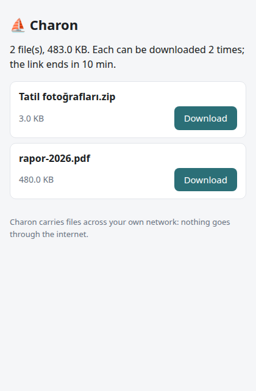
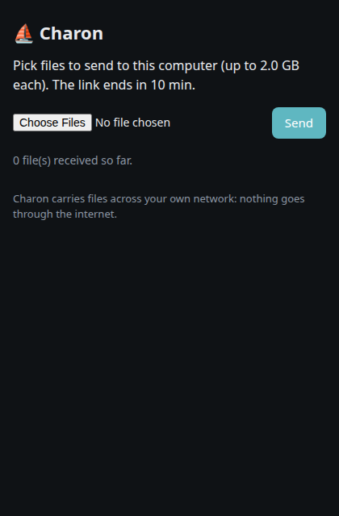

# Charon


**Charon carries files across your own network**, from the laptop to a phone
or the other way round, without a cloud service, an account or a cable. It
prints a link and a QR code; the link is secret (128 random bits), works
**once** (or as many times as you say), **ends after 10 minutes**, and is
served over **TLS**. When everything has been downloaded, Charon exits.

```
$ charon send "Tatil fotoğrafları.zip" rapor-2026.pdf
TLS certificate (this machine's): SHA-256 04:E4:F6:17:83:8F:64:B6:44:D4:…
Sharing 2 file(s), 483.0 KB, for 10 min; each can be downloaded 1 time(s).

  (QR code)
https://192.168.1.6:8765/811f14d1752cf611e677bea6169cc59f/

19:52:10 UTC  192.168.1.23 downloaded Tatil fotoğrafları.zip (3.0 KB)
19:52:14 UTC  192.168.1.23 downloaded rapor-2026.pdf (480.0 KB)
Done: everything was downloaded.
```

| Phone, downloading (`charon send`) | Phone, sending to the laptop (`charon receive`) |
|---|---|
|  |  |

## Use

```sh
charon send FILE...            # share files: scan the QR code with the phone
charon receive                 # a page where the phone can send files to ~/Downloads/Charon
charon receive ~/Inbox --uploads 1   # ... into ~/Inbox, and stop after one file
charon fingerprint             # this machine's certificate fingerprint
```

| Option | Default | |
|---|---|---|
| `--minutes N` | 10 | the link ends after N minutes (at most a day) |
| `--downloads N` | 1 | `send`: how often each file can be downloaded; an interrupted download does not count |
| `--uploads N` | no limit | `receive`: exit after N files |
| `--max-size SIZE` | 2G | `receive`: largest file accepted (`500M`, `2G`; decimal units) |
| `--port N` | 8765 | another free port if this one is taken |
| `--bind ADDRESS` | all | listen on one address only |
| `--http` | off | no TLS; only on a network you trust completely |

## How it protects the files

- **A secret link.** The URL path holds 128 random bits from the system
  generator, compared in constant time. Every other URL answers *404*, and
  after **30 requests with a wrong link** the share closes itself: someone on
  the network may be guessing.
- **Short-lived.** The link stops working after `--minutes` or once every file
  was downloaded `--downloads` times, and the program exits. Nothing keeps
  listening in the background.
- **TLS.** Charon makes a self-signed certificate for this machine on first
  use (`~/.local/share/charon`, `0600`), keeps it, and makes a new one when the
  machine's address is not in it (a laptop moves between networks). A phone's
  browser warns once about an unknown certificate; the SHA-256 Charon prints
  is what the browser shows under the certificate details. On a home network
  this stops anyone on the same Wi-Fi from reading the files on their way.
- **No leaks of the link.** `Referrer-Policy: no-referrer`, a strict
  Content-Security-Policy (no inline script, nothing from other sites),
  `no-store`, no framing.
- **Uploads cannot touch other files.** The name a browser sends is reduced
  to its last part, letters, digits and a few signs (`../../.bashrc` becomes
  `bashrc`), and the file is created with `O_EXCL`: an existing file or
  symlink is never replaced (`photo (1).jpg` instead). Uploads go to a hidden
  `.part` file first and appear only when complete, owner-only (`0600`).
  Oversized uploads are refused before a byte is stored.
- **A small server.** One request per connection, headers capped at 16 KiB,
  bodies only with a `Content-Length`, read and write timeouts. Built on
  rustls 0.23 with *ring*; no web framework.

## Install

```sh
git clone https://github.com/fas0ftware/charon && cd charon
cargo build --release
install -m 0755 target/release/charon ~/.local/bin/
```

Without a local Rust toolchain:
`docker run --rm -v "$PWD":/src -w /src rust:1-slim cargo build --release`.
A firewall has to let the port in (`sudo ufw allow 8765/tcp`, or the port you
choose).

## Tests

```sh
cargo test        # 13 tests
cargo clippy --all-targets -- -D warnings
```

Unit tests for the HTTP parser (limits, garbage, percent decoding), names
(path tricks, header injection, Turkish letters), unique file creation next to
a symlink, the download counter, closing on expiry or guessing, and the
certificate (kept, renewed for a new address, private). Integration tests run
the real server on 127.0.0.1: a one-time download over plain HTTP and over TLS
(checked against the certificate), a file name with HTML in it, uploads with
`../` in the name, a duplicate, an oversized one, a missing length and a cut
body, and 30 wrong links. CI also shares a file over TLS with `curl` and runs
`cargo audit`.

## Roadmap

- `charon send --text "..."`: share a note or a password once, shown on the page.
- A folder as one `.zip`, streamed.
- Local time in the log (now UTC, to stay free of a time-zone database).

## License

[MIT](LICENSE)
